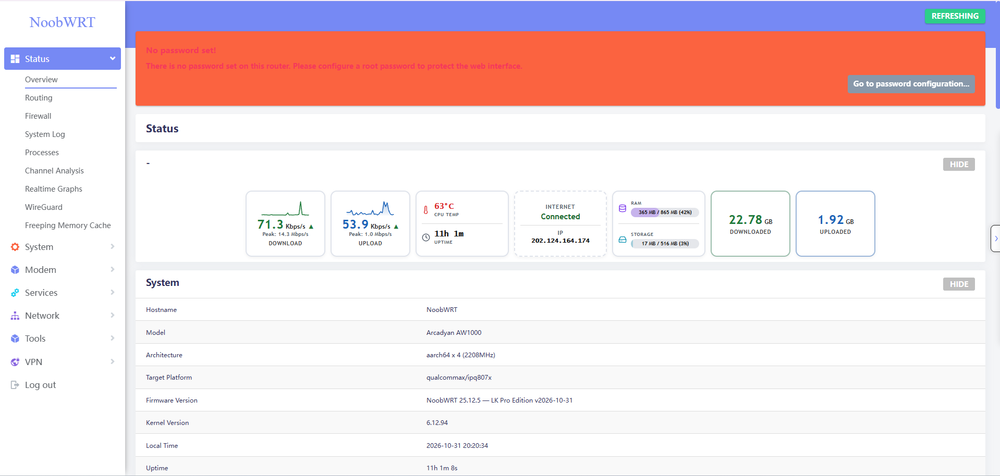
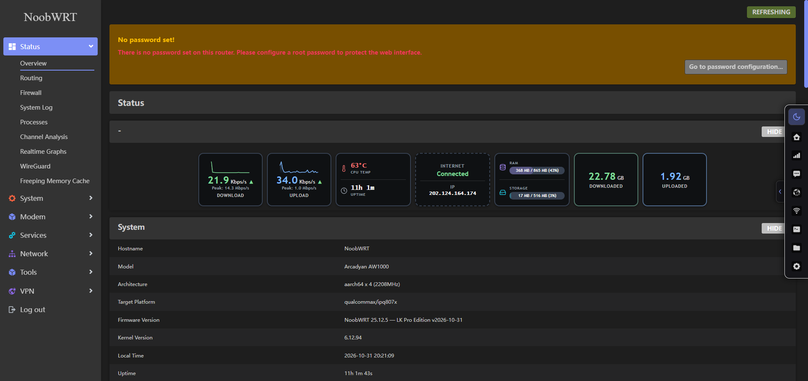
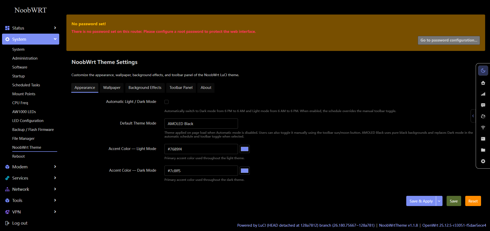
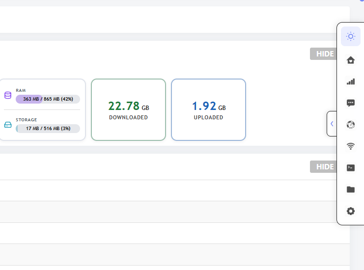
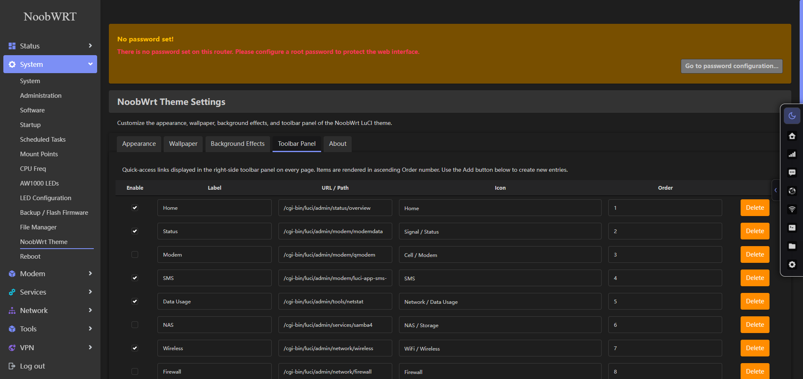
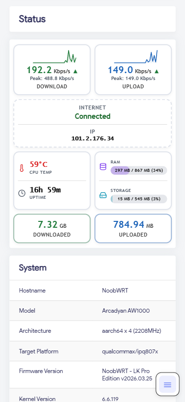
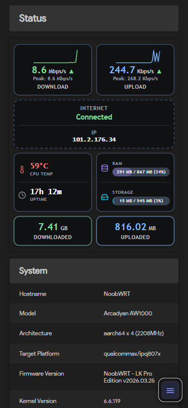
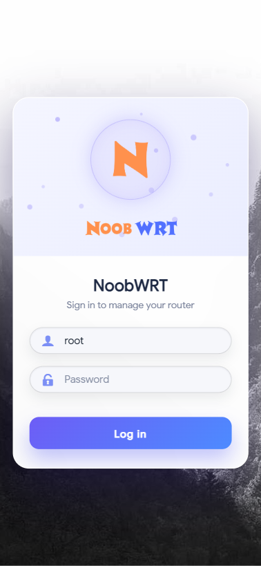

<h1 align="center">NoobWrt</h1>

<p align="center">
  A customizable LuCI theme for OpenWrt.<br>
  Light, Dark, and AMOLED Black. Your colors, your wallpaper, your shortcuts.
</p>

<p align="center">
  <a href="https://github.com/nooblk-98/luci-theme-noobwrt/releases/latest"></a>
  <a href="https://github.com/nooblk-98/luci-theme-noobwrt/releases"></a>
  <a href="LICENSE"></a>
  <a href="https://github.com/nooblk-98/luci-theme-noobwrt/pulls"></a>
</p>

<p align="center">
  <a href="https://github.com/nooblk-98/luci-theme-noobwrt/releases/latest"><b>Download</b></a> ·
  <a href="#screenshots">Screenshots</a> ·
  <a href="#installation">Installation</a> ·
  <a href="#configuration">Configuration</a> ·
  <a href="#development">Development</a>
</p>

---

NoobWrt brings a consistent appearance to your router's web interface, with separate light and dark accents, scheduled theme switching, a customizable login page, and a toolbar for the pages you use most.

| Feature | What you can customize |
| --- | --- |
| **Three color modes** | Choose Light, Dark, or AMOLED Black with pure black main surfaces. |
| **Accent colors** | Set separate light and dark accents for buttons, progress bars, and active states. |
| **Automatic switching** | Use a daytime light theme and a nighttime Dark or AMOLED Black theme. |
| **Login backgrounds** | Choose an online wallpaper source or upload your own image. |
| **Quick-access toolbar** | Choose the links, icons, and order of your shortcuts. |
| **Responsive layout** | Use the same theme on desktop and mobile browsers. |

## Screenshots

The desktop screenshots were captured on an Arcadyan AW1000 running OpenWrt 25.12.5. Available menu entries and status widgets depend on your firmware and installed packages. Select any image to view it at full size.

### Light and Dark

<table>
  <tr>
    <td width="50%" align="center">
      <a href="screenshots/overview-light.png"></a>
      <br><sub><b>Light</b> · Router overview</sub>
    </td>
    <td width="50%" align="center">
      <a href="screenshots/overview-dark.png"></a>
      <br><sub><b>Dark</b> · Router overview</sub>
    </td>
  </tr>
</table>

### AMOLED Black

Pure black main backgrounds, subtle near-black controls, and your existing dark accent color.

[](screenshots/appearance-amoled.png)

### A toolbar that fits your workflow

<table>
  <tr>
    <td width="36%" valign="top" align="center">
      <a href="screenshots/toolbar-panel.png"></a>
      <br><sub><b>Quick access</b> · Theme toggle and page shortcuts</sub>
    </td>
    <td width="64%" valign="top" align="center">
      <a href="screenshots/toolbar-settings.png"></a>
      <br><sub><b>Your shortcuts</b> · Configure links, icons, and order</sub>
    </td>
  </tr>
</table>

### Mobile

The original mobile previews show the overview in Light and Dark mode, plus the login page.

<table>
  <tr>
    <td width="33%" valign="top" align="center">
      <a href="screenshots/sc_mobile.png"></a>
      <br><sub><b>Light</b> · Mobile overview</sub>
    </td>
    <td width="33%" valign="top" align="center">
      <a href="screenshots/sc_mobile_dark.png"></a>
      <br><sub><b>Dark</b> · Mobile overview</sub>
    </td>
    <td width="33%" valign="top" align="center">
      <a href="screenshots/sc_mobile_login.png"></a>
      <br><sub><b>Login</b> · Mobile sign-in</sub>
    </td>
  </tr>
</table>

## Installation

Download the theme package for your OpenWrt series from the [latest release](https://github.com/nooblk-98/luci-theme-noobwrt/releases/latest), then copy it to `/tmp` on your router.

| OpenWrt series | Theme package | Package manager |
| --- | --- | --- |
| **24.10** | `luci-theme-noobwrt_…_all.ipk` | `opkg` |
| **25.12** | `luci-theme-noobwrt-….apk` | `apk` |

The theme packages are architecture independent. Releases also include optional Simplified Chinese translations and a `SHA256SUMS` file.

### OpenWrt 24.10

Run on the router:

```sh
opkg install /tmp/luci-theme-noobwrt_*.ipk
```

### OpenWrt 25.12

Run on the router:

```sh
apk add --allow-untrusted /tmp/luci-theme-noobwrt-*.apk
```

After installation, refresh LuCI. If you need to select the theme manually, open **System → System → Language and Style** and choose **NoobWrt** as the design.

## Configuration

Open **System → NoobWrt Theme**. Settings are organized into **Appearance**, **Wallpaper**, **Background Effects**, **Toolbar Panel**, and **About** tabs. Use **Save & Apply** to apply your changes.

### Choose a color mode

1. Open the **Appearance** tab.
2. Set **Default Theme Mode** to **Light**, **Dark**, or **AMOLED Black**.
3. Leave **Automatic Light / Dark Mode** off to keep your selected mode throughout the day, or enable it for scheduled switching.

| Setting | Behavior |
| --- | --- |
| **Default Theme Mode** | Determines the theme applied on page load when automatic switching is off. |
| **Automatic Light / Dark Mode** | Switches to Light from **6 AM to 6 PM**, and Dark from **6 PM to 6 AM**, using the browser's local time. If AMOLED Black is selected, it replaces Dark during the night period. |
| **Accent Color — Light Mode** | Controls the light theme's accent color. |
| **Accent Color — Dark Mode** | Controls the accent used by both Dark and AMOLED Black. |

The toolbar's sun/moon button switches the theme manually. With automatic switching enabled, the schedule takes effect again on the next minute tick.

### Personalize the login page

In **Wallpaper**, select an online source or upload a JPG, PNG, or WebP image.

| Source | Background |
| --- | --- |
| **None** | Use your uploaded image or the built-in background. |
| **Bing Daily Photo** | Bing's daily wallpaper. |
| **Lorem Picsum** | A randomly selected photo. |
| **Wikimedia Picture of the Day** | The featured daily image from Wikimedia. |

Online image URLs are cached for 12 hours. **Revert to Default** removes the uploaded wallpaper. The **Background Effects** tab provides separate blur and opacity settings for light and dark mode.

### Set up the toolbar

The toolbar sits on the right edge of the page. Hover over the chevron tab to peek at it, or click the tab to pin it open or closed. Its open/closed state is saved in your browser.

In **Toolbar Panel**, configure each shortcut:

| Field | Purpose |
| --- | --- |
| **Enable** | Show or hide the shortcut. |
| **Label** | Set the tooltip shown on hover. |
| **URL / Path** | Link to a LuCI page, such as `/cgi-bin/luci/admin/status/overview`. |
| **Icon** | Choose an icon for the destination. |
| **Order** | Arrange shortcuts in ascending order; lower numbers appear first. |

Point shortcuts to pages provided by the applications installed on your router.

## Troubleshooting

<details>
<summary><b>The old styling is still visible after an upgrade</b></summary>

Perform a hard refresh or clear the browser's cached files for LuCI, then reload the page.

</details>

<details>
<summary><b>The theme changes back after using the toolbar toggle</b></summary>

Check **Automatic Light / Dark Mode** in the Appearance tab. When enabled, the schedule overrides the temporary toolbar choice on the next minute tick. Disable it to use manual switching.

</details>

<details>
<summary><b>A toolbar shortcut opens a missing page</b></summary>

Edit its **URL / Path** under **Toolbar Panel** to match an installed application's LuCI page, or disable the shortcut.

</details>

## Development

### Build an OpenWrt package

From a configured OpenWrt build tree with the LuCI feed installed:

```sh
git clone https://github.com/nooblk-98/luci-theme-noobwrt.git package/luci-theme-noobwrt
make menuconfig
# Select LuCI → Themes → luci-theme-noobwrt
make package/luci-theme-noobwrt/compile V=s
```

Release packages are built with the OpenWrt 24.10.0 and 25.12.1 SDKs.

### Work on the styles

From this repository's root:

```sh
npm ci
npx lessc less/cascade.less htdocs/luci-static/noobwrt/css/cascade.css
npx lessc less/dark.less htdocs/luci-static/noobwrt/css/dark.css
```

Edit the LESS sources and include the regenerated CSS in style changes.

| Location | Contents |
| --- | --- |
| [`less/`](less/) | Theme styles and responsive rules. |
| [`htdocs/luci-static/noobwrt/`](htdocs/luci-static/noobwrt/) | Compiled CSS, fonts, icons, and images. |
| [`htdocs/luci-static/resources/view/noobwrt/`](htdocs/luci-static/resources/view/noobwrt/) | LuCI theme settings view. |
| [`ucode/template/themes/noobwrt/`](ucode/template/themes/noobwrt/) | Page headers, login templates, and toolbar. |
| [`root/`](root/) | Default configuration, wallpaper RPC helper, menu, and permissions. |
| [`po/`](po/) | Translations. |

## Contributing and support

Found a bug or have a feature request? [Open an issue](https://github.com/nooblk-98/luci-theme-noobwrt/issues). For bugs, include your OpenWrt version, theme version, browser, and steps to reproduce the problem.

[Pull requests](https://github.com/nooblk-98/luci-theme-noobwrt/pulls) are welcome. Check changes in Light, Dark, and AMOLED Black, including a mobile viewport, and update the documentation when behavior changes.

See the [release notes](https://github.com/nooblk-98/luci-theme-noobwrt/releases) for the change history.

## License and credits

Developed by [NoobLk](https://github.com/nooblk-98) and [contributors](https://github.com/nooblk-98/luci-theme-noobwrt/graphs/contributors). Licensed under the [Apache License 2.0](LICENSE).

With thanks to [luci-theme-argon](https://github.com/jerrykuku/luci-theme-argon) and [luci-theme-material](https://github.com/LuttyYang/luci-theme-material) for the original inspiration.
